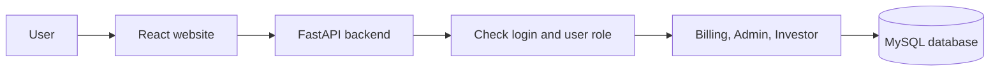
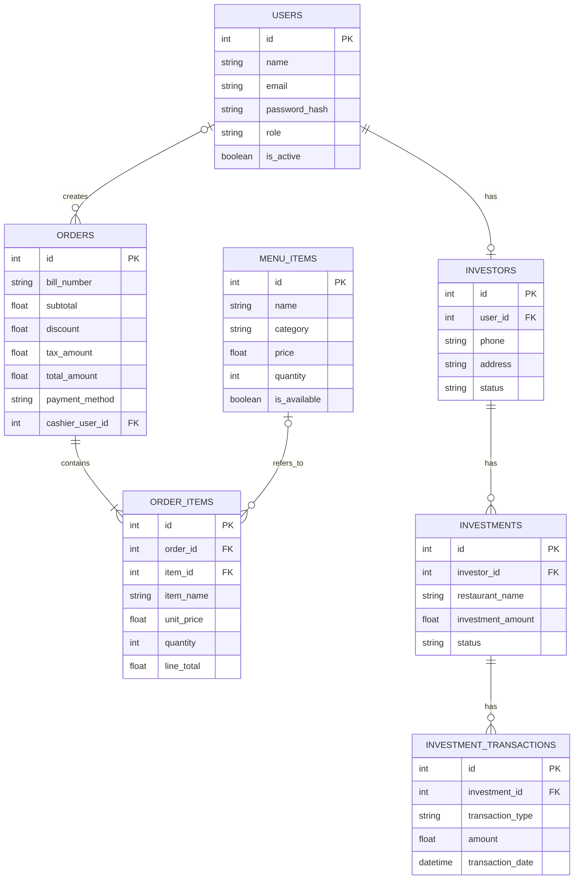
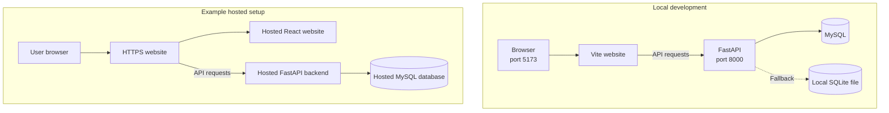

# Restaurant Billing and Investor Management System

## 1. About the project

This is a web app for managing restaurant bills and investor information.

It has three types of users:

- **Admin** manages the system.
- **Cashier** creates bills.
- **Investor** checks their investment information.

## 2. Project objective

The goal is to keep restaurant billing and investment information in one app. Users see different pages depending on their role.

## 3. What the app can do

### Admin

- View the dashboard and reports.
- Add and update menu items.
- Manage investor accounts.
- Add and update investments.
- Record investment returns or distributions.
- Create bills and view billing history.

### Cashier

- View available menu items.
- Create a bill.
- View past bills.

### Investor

- View their profile.
- View their investments and transactions.
- View a summary of their investment information.

### Not included

The app does not process card or UPI payments. It only saves the payment method on a bill. It also does not send investment payments or provide investor verification.

## 4. Technology used

| Part | Technology |
|---|---|
| Website | React |
| Backend API | Python and FastAPI |
| Database connection | SQLAlchemy |
| Main database | MySQL |
| Login | JWT access token |

## 5. How the app works

The website sends requests to the backend. The backend checks the request and user role, then reads or saves information in the database.

In local development, Vite sends `/api` requests to the backend on port `8000`. The backend uses MySQL when it can connect. If it cannot connect, it uses a local SQLite file instead.



## 6. Database

The app has seven main tables:

| Table | What it stores |
|---|---|
| `users` | Login details and user role. |
| `menu_items` | Menu names, prices, availability, and stock. |
| `orders` | Bill details and totals. |
| `order_items` | Items included in each bill. |
| `investors` | Investor contact and account status. |
| `investments` | Investment details for each investor. |
| `investment_transactions` | Returns or distributions for an investment. |

### Database diagram



An order item keeps a copy of the menu item name and price. This helps keep old bills the same if the menu changes later.

## 7. Main API addresses

The backend runs at `http://localhost:8000` during local development.

| Address | What it does |
|---|---|
| `POST /api/auth/login` | Log in. |
| `GET /api/auth/me` | Get the logged-in user's details. |
| `GET /api/billing/menu` | View available menu items. |
| `POST /api/billing/orders` | Create a bill. |
| `GET /api/billing/orders` | View bill history. |
| `GET /api/investor/profile` | View an investor profile. |
| `GET /api/investor/investments` | View an investor's investments. |
| `GET /api/investor/summary` | View an investor summary. |
| `/api/admin/...` | Admin dashboard, menu, investor, investment, and report features. |

The full API list is available at `http://localhost:8000/docs` when the backend is running.

## 8. Login and access

Users log in with an email and password. The backend returns a token. The website sends this token when it calls protected API addresses.

The backend checks the user's role before allowing access. For example, only an admin can change menu items.

## 9. Run the project on your computer

### Requirements

- Python 3.9 or newer
- Node.js 18 or newer
- MySQL 8 or newer (recommended)

### Start the backend

Open PowerShell in the project folder and run:

```powershell
cd backend
python -m venv venv
.\venv\Scripts\Activate.ps1
pip install -r requirements.txt
Copy-Item .env.example .env
```

Open `backend/.env` and add your database details. Change the JWT secret to a private value.

Start the backend:

```powershell
uvicorn app.main:app --reload --port 8000
```

To add sample data, open another PowerShell window:

```powershell
cd backend
.\venv\Scripts\Activate.ps1
python -m app.seed
```

The seed command adds sample users, menu items, investments, and bills if the database is empty. **Do not use `python -m app.seed --reset` if you need to keep existing data.** It deletes and recreates the app tables.

### Start the website

Open another PowerShell window and run:

```powershell
cd frontend
npm install
npm run dev
```

Open `http://localhost:5173` in your browser.

## 10. Deployment diagram

The left side shows local development. The right side is an example of how the app could be hosted. The production setup is not included in this project.



## 11. Things to remember

- Do not use the sample passwords for a real deployment.
- Keep the database password and JWT secret private.
- The app's logout clears the token from the website. It does not cancel an existing token on the backend.
- The database stores prices and investment amounts as floating-point numbers. This may need to change for exact financial calculations.
- The project has local development instructions, but no production hosting setup.
